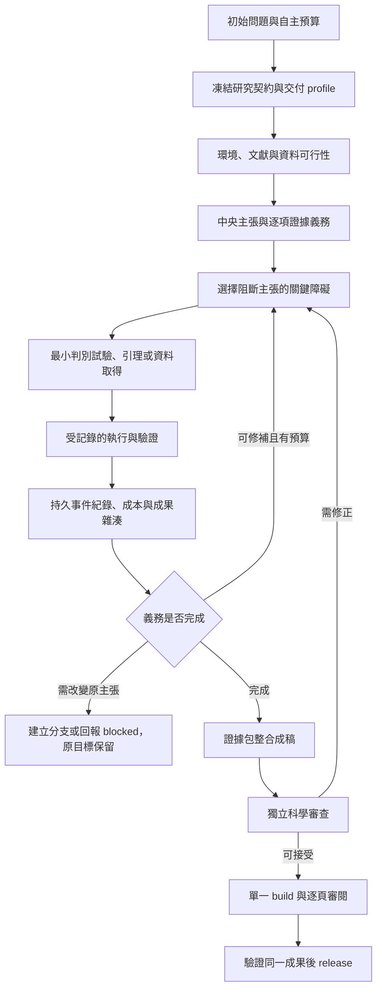

# 自主經濟研究 Harness 的優化與驗證：研究計劃

版本：1.0；日期：2026-10-16；狀態：待實作的研究與工程計劃。

基線：Invisible Hands for Economists 2.18.0 的既有工作樹快照。本文提出改良方案與評估方法，不代表下列功能已完成或實驗假說已成立。

## 摘要

本研究旨在把目前以研究規範、證據圖譜與審計工具為主的 harness，改良為能在一次初始委派後，於明確範圍與預算內，完成可重現、主張有依據且接受獨立審查之經濟研究的系統。研究同時涵蓋實證、理論、結構模型與財務應用，但先完成少量可靠案例，再擴充領域。

初步實驗已從一句問題復原 AER 最低工資研究的平衡樣本核心估計，並寫出 Econometrica 談判模型的多類均衡與證明。兩案均產生可讀稿件，卻未完整復原原文，也未通過全部交付檢查；且存在模型記憶、搜尋暴露與帳戶用量中斷。因此，後續研究的目標是驗證改良是否提高可信研究的完成率，而非讓更多 JSON 顯示通過。

方法上比較三個版本：不使用本 harness 的通用 agent、凍結現版 harness、改良版 harness。各版本共用模型、工具、研究契約與預算，採同題區組內隨機分派、獨立執行與外部盲評。精確復原、研究可信性、工程交付與原創貢獻分開評估。無改善、品質下降與證據不足均是可接受的研究結論。

## 1. 問題界定與初步證據

### 1.1 已有能力與尚未證明的能力

目前已有文獻搜尋、資料來源、識別、機制、證明、數字綁定、論文章節、獨立審查及排版規範。優化的重點是把既有要求落實為可執行、可恢復、無法藉改寫成功條件而過關的流程。

| 初步觀察 | 證據可支持什麼 | 不能據此支持什麼 |
|---|---|---|
| AER 案主估計 2.75 FTE；384 完整配對；獨立 R 核對 116 個數值一致 | 核心資料處理及數值實作正確 | 政策反事實已識別、原文所有分析已復原 |
| 清空生成成果後，結果樹、四張表與 TeX 均可復原 | 凍結輸入下的計算與文本生成可重現 | 原始資料充分、估計策略正確、整個 package 成功 |
| 理論案 10 項核心主張、11 項證明義務通過獨立 agent 審查 | 明示模型類別內的可讀論證有審查依據 | 原文一般偏好定理已復原、Lean kernel 已驗證 |
| 最終 PDF 與 review 雜湊一致，但 package 仍失敗 | 審閱紀錄可驗 freshness；交付流程存在斷點 | 所有失敗都是研究能力不足 |
| 文獻／資料受限、搜尋未完成、模型記憶及配額中斷 | 需要分開記錄外部阻塞與方法問題 | 兩案可估整體 one-shot 或刊別成功率 |

主要依據：[實驗報告](../../experiments/one-shot-reconstruction/2026-10-12/report.md)、[scorecard](../../experiments/one-shot-reconstruction/2026-10-12/research/scorecard.json)、[最終 artifact 審計](../../experiments/one-shot-reconstruction/2026-10-12/research/reviews/final-artifact-audit.json)。原始快照與失敗紀錄保留，不作後見之明修訂。

### 1.2 三個不同的研究終點

1. **精確復原既有研究**：目標估計、定理、樣本、必要輸入及容差均事前指定，檢驗是否重現。單句問題通常無法唯一決定原文每一個規格與附加分析。
2. **完成可信研究稿**：按事前契約完成問題、方法、證據、論證及可重現成果；結論可以是零效果、反例或不確定，但不能偷換原問題或省略必要義務。
3. **形成新的重要貢獻**：相對已核驗近作，提出值得知道且有可信驗證的新差異。須另行評估，不能由復原率、篇幅或 package 通過推導。

本研究以第二項為主要產品目標，以第一項校準執行能力，以第三項作後續探索性研究。頂刊接受不作可保證的系統輸出。

## 2. 研究問題、假說與成功定義

### 2.1 研究問題

- RQ1：相同模型、工具、輸入權限及預算下，改良版能否提高按契約完成且沒有嚴重研究錯誤的比例？
- RQ2：逐項證據義務與關鍵障礙迴圈，能否降低遺漏、未經授權的範圍縮減，以及無依據的因果或一般性主張？
- RQ3：持久狀態、可信重跑與單一 build 的交付流程，能否降低人工救援、重複工作及狀態不一致？
- RQ4：系統能否辨認一個有價值的文獻缺口，提出可被否決的研究路線，並完成相應驗證？

### 2.2 可否證假說

| 假說 | 主要觀察 | 不支持假說的情況 |
|---|---|---|
| H1：改良版提高契約完成率 | 改良版相對現版的任務層級完成率差 | 差值未改善，或不確定區間不足以支持改善 |
| H2：改良版減少嚴重科學錯誤 | 各臂所有分派 runs 的嚴重錯誤率 | 嚴重錯誤增加，或資料不足以支持減少 |
| H3：改良版提高中央主張義務覆蓋 | 必要義務中獲支持、被反駁或如實未解的比例及完整性 | 只增加章節／schema，仍漏掉必要分析或弱化主張 |
| H4：改良版降低可避免的恢復成本 | 預設中斷測試中的重工、預算遺失與人工操作 | 重啟仍丟任務、重設成本、重算已完成工作或發布過期狀態 |
| H5：貢獻篩選能產生可驗證的增量 | 外部評審對近作重疊、重要性及驗證的判斷 | 候選被近作吸收、不可驗證，或僅為無新增經濟內容的設定變更 |

H1 為主要確認性比較；H2–H4 為預先登錄的次要比較，須處理多重比較。H5 起初為探索性，不與前四項混成單一分數。小樣本未發現嚴重錯誤，不等於證明風險為零。

### 2.3 一次委派的操作定義

初始輸入包含研究問題、可使用資料／服務、交付型態、自主預算及允許的調整。系統可內部多次搜尋、估計、證明、反駁、改稿及審閱。計算失敗可修復；研究主張只能在原契約授權內調整。

分別報告「不中斷完成」與「保存狀態後恢復完成」。帳戶配額、付費權限或宿主不支援恢復時，應保存狀態並回報外部阻塞；harness 不能承諾突破這些限制。使用者的操作性繼續指令與提供新識別策略等科學性救援分開計數。

若原任務要求一般定理，較窄命題可成為有價值的分支成果，但原目標仍未完成。若原契約要求回答因果問題，描述性稿件須標示範圍受限，不能因篇幅完整就算原任務成功。

## 3. 改良後的研究流程與信任邊界

### 3.1 一份契約，多個明確狀態

沿用現有 manifest、package、ledger；只新增必需欄位或薄型工具，避免平行維護另一套追蹤框架。

| 狀態軸 | 回答的問題 | 禁止的推論 |
|---|---|---|
| 執行狀態 | 完成、中斷、crash、預算耗盡或外部 blocked？ | 程式 exit 0 等於研究正確 |
| 主張狀態 | 每項主張受支持、暫定、被反駁或未獲支持？ | 自填 pass 等於實質證據 |
| 範圍完成度 | 原契約的必要資料、分析、證明是否全數處理？ | 較窄分支完成等於原目標完成 |
| 交付狀態 | 所需檔案、重跑及 review 是否有效且一致？ | 一份 PDF 等於完整證據包 |
| 貢獻評估 | 相對已核驗文獻新增什麼、何以重要？ | gate 通過等於頂刊貢獻 |

保留規範中「不以效果方向、係數大小、p 值或迎合研究者直覺作 reward」的限制。reward 的必要 gate 分母由外部凍結契約決定，不能藉新增容易的檢查或刪除難的義務提高分數。

### 3.2 分層驗證

- deterministic checker 驗檔案、雜湊、數值一致性、依賴完整性及執行結果。
- fresh-context agent 或人類領域評審判斷經濟意義、識別、語義支持及證明漏洞；記錄評審類型，不能把 agent 審查寫成人類專家驗證。
- 只有既有鎖定 Lean statement／proof／axiom 流程實際通過，才使用 formally proved。完整可讀證明可以另行交付，但不冒稱 kernel verification。

executor 提供的自述、trusted runner 觀察與外部評分分開保存。argv 與 cwd 檢查不是 OS sandbox；有實際權限隔離才宣稱隔離。沒有此能力時揭露限制，並以凍結 contract／harness／raw hashes 偵測越界。

## 4. 工作包與可驗收交付物

### WP1：研究契約與必需檢查 profile（P0）

**問題：** 目前 package 由宣告哪些欄位決定檢查什麼，容易把局部 valid 誤當成完整交付。

**改良：** 凍結研究模式、交付型態、主張層級、必要成果與 gate IDs。區分可行性、復現、描述性研究、因果研究、分析理論、形式證明及結構模型；混合研究按子主張組合義務。核准的不適用項目須有理由。完整稿仍要求完整 TeX，正式理論驗證只在聲稱 formally proved 時強制 Lean。

**重用／修改：** [package checker](../../scripts/check_research_package.py)、[research artifacts](../../references/research_artifacts.md)、[SKILL](../../SKILL.md) 與安裝鏡像、對應 tests。

**驗收：** 刪除必要 design、structural、topic 或 TeX 欄位不會增加完成率；missing／skipped config 永遠不算研究完成；可行性成果不被無關稿件檢查卡住，也不能冒稱 manuscript-ready。原始與調整後契約版本、預期輸出與允許調整都可追蹤。

### WP2：逐項主張、證據、範圍與推論一致性（P0；依賴 WP1）

**問題：** 現有圖譜能驗連結，但找到一條 evidence 路徑不代表結論內每項義務都被支持。

**改良：** 在既有 graph 加必要 obligation、domain、sample、estimand、assignment unit、inference 程序與模型假設參照。主文、附錄、表圖的必要結果共同納入；範圍增加與假設強化須顯式版本化。保留現有機制與效果分開驗證的規則。

**重用／修改：** [manifest validator](../../scripts/validate_research_manifest.py)、[claim audit](../../scripts/audit_claims.py)、[result bindings](../../scripts/check_result_bindings.py)、[design audit](../../scripts/check_design_audit.py)、[logic review](../../scripts/check_logic_review.py)、coverage 與相關 tests。

**驗收：** 只支持 A 的證據不能讓 A+B 結論完成；contraction 子類證明不能支持一般偏好定理；州級 assignment 不能以餐廳 iid SE 自填 inference=pass。必要表圖即使在附錄也須綁定；漏掉一項必要義務時，外部 reviewer 與機器覆蓋報告均能定位。

**科學規範同步：** 檢查 falsification battery 與 referee 規則中的通用顯著性門檻，統一為設計對應的事前判讀；補足精度／最小有意義效果、零結果解讀、確認性與探索性檢定家族，以及結構參數與 counterfactual 不確定性。適用性由任務決定，不能把所有檢查套到所有論文。

### WP3：可信執行與乾淨重跑（P0；依賴 WP1）

**問題：** 數字與 JSON 一致，仍不代表它由指定資料及估計程式產生。

**改良：** 用薄型 runner 執行凍結 entry point，記錄環境、seed、輸入／輸出雜湊、exit code、完整 log 與數值比較。刪除生成成果後重跑；容差事前指定。對關鍵估計採小型獨立實作或已知答案案例，因可重現程式也可能穩定地算錯。

**重用／修改：** [replication protocol](../../references/replication_audit.md)、result／package checker，並重用本次 [clean replay](../../experiments/one-shot-reconstruction/2026-10-12/scripts/clean_replay.py) 的已驗證做法。需要時增加一支薄型 replication checker，不建新通用工作流平台。

**驗收：** 隱藏所有舊 results／tables／figures 後仍生成必要成果；植入 stale table、遺漏 raw input 或「程式輸出 0、JSON 寫 999」均被發現；已知 DGP 與獨立實作能發現錯誤估計。重跑憑證明示：計算復現不等於因果識別、歷史原文復原或新意成立。

### WP4：關鍵科學障礙迴圈（P0；依賴 WP1–WP3）

**問題：** 流程可能一直增補文字或低辨識力檢查，沒有推進最重要的主張。

**改良：** 每輪記一個 obstacle ID、受影響主張、最強替代解釋／反例、最小判別試驗、預測、所需輸入、結果與下一動作。先處理阻斷中央主張的問題，再處理表述與排版。

**重用／修改：** [research protocol](../../references/research_protocol.md)、empirical／theory／structural references、既有 ledger、package failure stages 與 Dream-RSI action selection。

**驗收：** 最低工資案遇州級反事實缺口時，下一步是取得判別證據、敏感度／界限分析或 honest block；不能以新增無關回歸消除缺口。理論案移除 contraction 後，須定位失效步驟並提出引理或反例；不能把更強假設下的結果改標為一般定理。連續相同失敗且無新證據時停止或轉入授權的範圍決策。

### WP5：持久狀態、累計成本與有限自動修補（P0／P1；基礎依賴 WP1，科學動作整合依賴 WP4）

**問題：** 目前 loop 重進可重設成本，next actions 可覆蓋待辦；配額中斷後也有過期摘要。

**改良：** 沿用 append-only JSONL，保存 run ID、contract hash、action started／finished、pending queue、成果指紋、累計預算及 retry。從事件推導最新摘要，不把多份手寫狀態當真值。修補先支援 CLI、相對路徑、build 設定及缺失 artifact，限制寫入範圍並記錄 patch。

**重用／修改：** [Dream loop](../../scripts/dream_replay_simulator.py)、[action adapter](../../scripts/research_action_adapter.py)、[Dream protocol](../../references/dream_rsi.md)、對應 tests；優先使用宿主已有執行與 agent 工具。

**驗收：** A 完成、B 待執行時中斷，恢復不丟 B、不重跑 A、不重設成本；執行後尚未記完成就中斷，先驗成果再決定重跑。同契約預算耗盡，繼續不會無聲獲得新預算。unsupported CLI 可被有限修補；缺識別證據不能靠改 status 修補。harness、raw data、必需 gates 與原假設遭未授權修改時，動作失效並保留紀錄。

### WP6：單一 build 的審閱與 release（P0；依賴 WP1、WP3）

**問題：** 單獨 build 與 package 的引擎不同，或 package 再編另一份 PDF，會破壞已完成的 review。

**改良：** preflight 鎖定 engine、依賴、字型與局部 runtime 設定，傳遞至全部步驟。build 保留 PDF、log、report、頁面及輸入依賴清單；review 綁該成果；release 驗同一份成果，不在最後偷偷重編。

**重用／修改：** [LaTeX checker](../../scripts/check_latex.py)、package checker、[LaTeX protocol](../../references/latex_validation.md)、既有 tests。

**驗收：** 可執行但缺 cache 的 engine 不被默認當成可用；全部頁面審閱後，release PDF SHA 必須等於 reviewed PDF SHA。TeX、bib、表圖或納入的 build dependency 改變後，舊 review 失效。允許並記錄局部可重現設定，不放寬 overfull 或其他硬性門檻。乾淨計算重跑與最終 PDF identity 是兩項分開的驗證。

### WP7：文獻、資料與貢獻判斷的執行鏈（P1；依賴 WP1、WP2，可並行）

**問題：** baseline/frontier、近作比較及取得資料的規範已存在，但尚未證明能完整執行並形成有價值的研究路線。

**改良：** 補可重跑的 acquisition queue、合法替代來源、access gap 與 source→file→schema→claim 關聯。每個候選研究用一張表回答：最近答案、仍受限之處、擬採取的新步驟、為何重要、會否定它的試驗。獨立 reviewer 先嘗試否決重疊或無法驗證的貢獻，再決定是否投入完整分析。

**重用／修改：** [literature search](../../scripts/search_literature.py)、topic／archive／data-provenance checkers、[topic survey](../../references/topic_survey.md)、[data acquisition](../../references/data_acquisition.md)、[contribution anatomy](../../references/breakthrough_anatomy.md)。

**驗收：** 模型記憶或 snippet 不能冒充已核驗全文；403 或權限缺失回報真實 gap；不捏造 PDF、授權或觀察值。未取得必要 ZIP／CPS 類輸入時，原完整復原仍未完成。duplicate 可以轉為有標示的 replication 分支，不能改名假稱 novelty。分開文獻取得狀態與實質支持狀態；必要來源缺失依契約阻擋，不能把所有 archive 失敗等同識別錯誤。

### WP8：代表性研究案例、規範一致性與發佈整合（P1；依賴 WP1–WP7）

**改良：** 先各完成一條 empirical、theory、structural 的小型可重跑路徑，加入 finance 任務；公用資料、模型、程式、預期成果與錯誤案例成套保存。標準資料庫 recipes、文字資料、機制與真實世界建議的 gates 依觸發條件啟用。期刊 profile 仍由已核驗 corpus 推導，十刊 registry 不冒充十套已完成模板或品質排名。

**重用／修改：** 各模式 references、method router、estimation backends、manuscript coverage、library、tests、README、兩份 SKILL、插件版本與包裝檢查。

**驗收：** 不需 counterfactual 的 structural 契約不被一律強迫增加該分析；聲稱 counterfactual 時仍必需對應義務。text-as-data 啟用其可靠性義務；real-world recommendation 啟用 applicability。每次發佈保留 API／CLI smoke checks、精確來源快照與相容性說明，避免生成腳本依不存在的參數或示例執行。

## 5. 實驗設計

### 5.1 比較條件

| 臂 | 條件 | 共同限制 |
|---|---|---|
| C0 | 通用宿主 agent，無本專案的研究流程提示、validators 或模板 | 仍收到必要的外部交付契約與操作說明 |
| C1 | 凍結現版 harness；使用原始工作樹快照與 hash | 不事後把已知修復塞回基線 |
| C2 | 凍結改良版 harness | 確認階段不能隨結果繼續調整版本 |

三臂使用同模型 snapshot／設定、工具與 backend、資料權限、可用 worker 數量、active time／運算／修訂上限。輸入提示與自行審查的成本皆入帳，不能給 C2 額外免費 reviewer。共同外部評分不要求 C0 產生本專案的 JSON schema；內部 gate 通過是次要結果。

### 5.2 任務類別與來源條件

- **執行驗證題**：提供問題、資料、codebook 與足夠的指定規格或模型，測算式、證明、重跑與成稿。
- **研究設計題**：提供問題與可用資料／模型邊界，保留方法與結果，測識別、模型選擇、關鍵威脅及完整性。
- **開放研究題**：只給問題與權限預算，測可行性、近作比較及貢獻；原創性先作探索性評估。

三類分開呈現，不能把提供規格的復現成功率當成問題獨立解決率。只在事前具備明確原文目標與足夠 inputs 的任務評 exact historical fidelity。工程用合成 DGP 可提供已知答案，但其結果不得支持真實人口的因果或政策主張。

### 5.3 題庫規模與階段

| 階段 | 規模 | 用途 |
|---|---|---|
| 舊案校準 | 現有 AER、Econometrica 兩題及植入錯誤 fixtures | 修復回歸、版本與評分流程；不再當 holdout |
| 新題 pilot | 6 題，empirical／theory／structural 各 2；每題 3 臂、各 2 次，36 runs | 調整預算、環境、rubric 與故障分類；至少納入 finance 題 |
| 確認比較 | 另外 20 題；每題 3 臂、各 2 次，120 runs | 凍結後主要比較；十刊各 2 題作 coverage，兼顧模式與難度 |
| 貢獻探索 | 確認版本下另立的小型開放研究 cohort | 評近作增量與可信驗證；不得沿用復現題宣稱創新 |

36／120 是擬實施規模，不是已完成結果或既有資源承諾。pilot 可先分批執行以檢查成本，但不能選擇只保留表現好的題。確認題數須在看見確認結果前，依 pilot 的任務層級變異、實務上有意義的差異與可用預算完成樣本數評估；若不足，結果定位為有界 pilot，不宣稱具足夠統計 power。

確認題來源按 [registry](../../library/journals.jsonl) 涵蓋 AER、Econometrica、JPE、QJE、REStud、JF、JFE、RFS、JFQA、Review of Finance。兩題／刊不足以估刊別成功率，也不是從期刊母體隨機抽樣。curator 需事前檢查合法來源、任務難度、輸入完整性與參考答案，主要確認題須在分派前通過可完成性預篩。刻意缺必要 inputs 或以來源禁令測正確停止的任務另立 cohort，不混入這 20 題的主要完成率；分派後意外發現的阻塞則保留在主要分母。

### 5.4 隨機化、隔離與記憶污染

每個 task×repeat 建立三個隔離 run slots，在區組內隨機分派 C0／C1／C2 及執行順序。不是把一題只分一臂。每次 fresh context，產物、搜尋快取與答案隔離；確認題庫每篇論文至多取一個任務，因此主要分析的 task 與 paper cluster 一致。開發測試若同篇多題，須以整篇為 cluster，不能把各題當獨立樣本。

舊兩題不得進入主要結果。新題優先選較不熟悉但可核驗的案例，並以參數／資料擾動檢查模型是否會適應真正改變的問題；這些擾動不是新的經濟貢獻。辨識既有文章、記得答案與搜尋暴露均記錄，fresh context 不證明不存在訓練記憶。

嚴格來源受限的任務，應由工具與讀取權限隔離 target／holdout；只有指令隔離時須揭露並另列。允許哪些資料、metadata、全文與原分析程式事前規定，三臂一致。不得因看見某臂結果不好才排除有污染或外部受阻的題。

## 6. 終點、評分與分析

### 6.1 主要終點

一個 run 在凍結預算內完成原契約的必要研究成果，且外部獨立審查未發現嚴重研究錯誤，記為契約完成。拒絕回答、缺必要義務、未交稿或縮成未獲授權的子問題不能靠「沒有錯誤主張」算成功。

若任務本來要求可行性判斷，完整且有依據的不可行結論可完成該契約；若原任務要求完整研究，blocked 報告有價值但不是原目標完成。零效果、反例與不確定結論依原問題及精度契約判定，不要求顯著正結果。

### 6.2 分開報告的次要終點

| 維度 | 指標／判斷 |
|---|---|
| 科學正確性 | 嚴重錯誤率、中央主張支持、識別／證明漏洞、假設與範圍一致 |
| 內容完整性 | 必要義務覆蓋、未解項目是否揭露、是否回答原問題 |
| 執行與交付 | 實際 gate、乾淨重跑、數值容差、有效 review、同一 release artifact |
| 精確復原 | 已預先指定的樣本、估計／SE、定理與必要輔助分析；與不同但有效的方案分開 |
| 貢獻 | 近作重疊、增量、重要性、可驗證性；保留評審不確定性 |
| 成本與自主性 | token／工具／運算費、active time、calendar time、操作性及科學性人工介入 |

嚴重錯誤至少包括資料／來源捏造、核心數值或證明錯誤、無依據因果／機制／一般性主張、把 proxy 當真實觀察、隱瞞中央缺口及虛稱正式驗證。編譯錯誤與文獻 access gap 另列，不能直接等同科學錯誤。

各 task 先彙總重複 runs，再計算 C2−C1 的 paired task-level contrast；C1−C0 為次要比較。報告任務層級不確定區間及逐題結果，不把 116 個數字、claims 或頁面當獨立樣本。確認分析方法、次要比較調整與敏感度分析在 pilot 後凍結；小樣本區間的限制明示。

主要分母保留主要確認 cohort 中所有分派任務及其 crashes、timeouts、blocked。分派後意外的來源或平台阻塞仍計入完成率，另標原因，不直接歸因為 harness 的科學錯誤。刻意缺 inputs／source-ban 的獨立 cohort 另報正確停止能力；主要 cohort 亦報來源充足與意外受阻的分層結果，避免完成者偏差。預定平台故障規則可補跑整個 task block，不只補較差的一臂；原紀錄仍保留。

### 6.3 評審與研究防洩漏

外部評分者盡量遮蔽臂別與執行歷史，依共同 rubric 審稿；格式可能洩露臂別時記錄實際盲評限制。自評 reviewer 與最終研究評分者分開，評分成本亦分列。

新貢獻與高風險理論／識別判斷，規劃人類領域評審並處理分歧；只有 agent 評分時標為 agent-only 證據，不能寫成專家或投稿級驗證。歷史 cutoff 可作輔助設計，但工具的日期過濾不會移除模型既有記憶。

## 7. 資源、排程與轉段條件

以下為 12 週工作分解示意，假設有一名實作負責人、兼任研究 PI／curator，以及可安排的獨立評估資源；不是已確認的人力或交付日期。依里程碑與實際資料權限調整，不以週數取代驗收。

| 里程碑 | 示意期程 | 交付與轉段條件 |
|---|---|---|
| M0 基線與契約 | 第 1 週 | 保存舊案／快照、區分三種研究終點；完成任務契約、rubric 與 failure taxonomy |
| M1 可靠執行骨架 | 第 2–3 週 | WP1、WP3、WP5、WP6；具體刪 gate／假數值／中斷／過期 PDF 負向案例全被正確處理 |
| M2 科學義務與障礙 | 第 4–5 週 | WP2、WP4、WP7；兩個舊案的關鍵缺口均能提出可判別下一步或 honest block，非只有增加文字 |
| M3 新題 pilot | 第 6–7 週 | 36 runs；完成成本、環境、rubric 校準；決定並凍結確認樣本數與預算 |
| M4 確認比較 | 第 8–10 週 | 凍結三臂與新題；按預定分母／分析報告，不邊測邊改版本 |
| M5 貢獻探索與發佈 | 第 11–12 週起 | 完成比較報告、限制、可重跑 release；另外規劃新貢獻 cohort，不宣稱頂刊接受 |

每個 run 的模型設定、可用工具、並行數、active-time 上限、總運算／修補預算在 manifest 寫明。pilot 先測可完成工程的合理上限，再對任務類型凍結相同的跨臂預算。既有 25／30 分鐘試跑不自動當成所有未來研究的足夠預算。

記錄可取得的實際 token 與費用；宿主不提供者標未知，不填零。成本公式為每臂所有分派 runs 的實際成本總額／成功交付數，成功數為零時報無成功或不可估，不刪失敗 runs。另報總成本、各類中斷與人工工時；不預先假設特定模型價格或自動購買額度。

## 8. 驗收、停止與研究誠信

### 8.1 工程最低驗收

在進新題 pilot 前，至少驗證以下負向情境；具體 fixtures、預期狀態與測試命令一起保存：

1. 刪必要 gate／以 skipped config 假完成。
2. 程式與 results 不符、舊表混入、缺 raw input。
3. 一項證據被錯用為多項中央義務的支持。
4. 理論子類假設被冒稱一般定理。
5. assignment／SE 層級不符而 diagnostic 自填 pass。
6. 中斷後 queue、成本與已完成成果遺失或重複執行。
7. CLI、build 路徑或 engine 設定出錯且未回傳可定位失敗。
8. 來源／正文／圖表改變後仍使用舊 review。
9. release 與 reviewed PDF 不同。
10. proxy、資料來源或正式證明狀態被錯標。

這些是可控制的工程測試，不取代真實研究評估。全部通過只足以進入 pilot，不能宣稱所有科學風險消失。

### 8.2 單 run 與整體研究停止

單 run 於完成契約、用完凍結預算、必要權限／inputs 不可取得，或需超出授權範圍時停止。schema 可修但科學義務不能豁免；失敗保留，不能以改 evaluator 換取通過。

pilot 後凍結版本 hashes、題庫／答案、rubric、來源政策、預算、隨機化種子、評分程序與主要比較。確認階段不得因中期結果好看而提前停止；發現答案外洩、評分核心缺陷或重大版本變動，暫停並保留紀錄，修正後另立版本與新 holdout。變更中的結果只能列開發證據。

採用改良版須同時有可重現工程改善、主張範圍可信，以及外部評估支持；若只讓內部 gates 更容易通過，或主要比較不支持改善，應縮減或撤回相應設計。若資源不足完成確認樣本，交付有界 pilot 報告，不改稱完整確認。

## 9. 預期研究產物與完成條件

- **系統產物**：最小契約 profile、義務圖譜、可信 runner、可恢復 action queue、單一 build/review/release、實際 acquisition／貢獻決策鏈；沿用現有 scripts 與宿主能力。
- **驗證產物**：單元／整合／植入錯誤測試、三種研究模式的可重跑小型案例、含 finance 的新題庫、三臂對照、成本及失敗原因。
- **研究報告**：H1–H5 的支持程度、逐題結果、不確定性、污染與外部限制；保留沒有改善或品質下降的結果。
- **使用者交付**：一次初始授權後，得到主張受支持的完整 working paper／replication package，或清楚標示原目標未完成的有限成果與阻塞原因。兩者不混稱成功。

首要完成條件是「系統在事前契約與共同外部標準下，能可靠完成可驗證的經濟研究」，其次再評估新穎性與重要性。頂刊 registry 提供範圍與風格目標，不是研究品質證明。

## 10. 可追溯依據與實作邊界

本計劃的實驗事實以本地保存證據為依據，不新增未核驗論文或模型價格建議：

- [初步實驗報告](../../experiments/one-shot-reconstruction/2026-10-12/report.md)與[最終 scorecard](../../experiments/one-shot-reconstruction/2026-10-12/research/scorecard.json)。
- [乾淨重跑](../../experiments/one-shot-reconstruction/2026-10-12/research/clean-replay.json)、[實證獨立核算](../../experiments/one-shot-reconstruction/2026-10-12/research/reviews/empirical-execution.json)。
- [獨立論證與視覺審查](../../experiments/one-shot-reconstruction/2026-10-12/research/reviews/fresh-manuscript-referee.json)、[artifact 與 package 審計](../../experiments/one-shot-reconstruction/2026-10-12/research/reviews/final-artifact-audit.json)。
- [現有研究 artifacts](../../references/research_artifacts.md)、[研究 protocol](../../references/research_protocol.md)、[Dream iteration](../../references/dream_rsi.md)、[期刊 registry](../../library/journals.jsonl)。

本段記錄 2026-10-12 計劃交付時的狀態；後續部分工程實作與五個合成案例的結果另見[工作流實作狀態](workflow-implementation-status.md)。36／120 runs 的受控評估與真實論文 one-shot 完成率仍未驗證。
